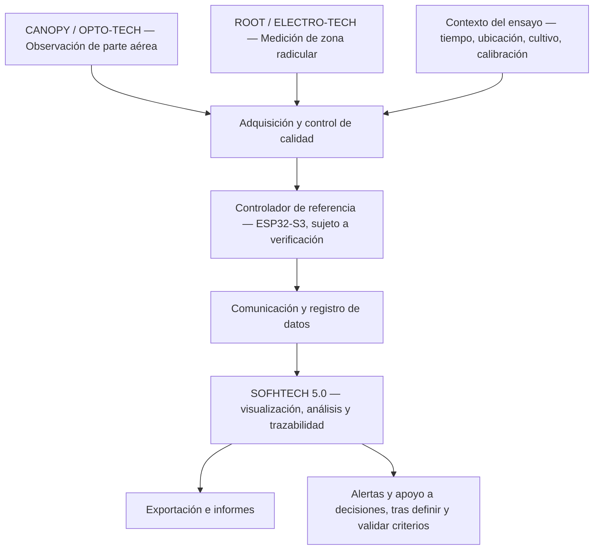

# AGRO-TECH 5.0 — Arquitectura funcional

**Estado:** arquitectura conceptual. Diagrama lógico, no plano de fabricación ni esquema eléctrico.

## Módulos

| Módulo | Función propuesta | Aspectos por verificar |
|---|---|---|
| CANOPY / OPTO-TECH | Observaciones ópticas y ambientales de la parte aérea | Sensor, variable objetivo, geometría, iluminación y calibración |
| ROOT / ELECTRO-TECH | Mediciones eléctricas/electrónicas en suelo o sustrato | Tipo de sensor, instalación, temperatura, salinidad y referencia |
| Controlador | Lectura, validación básica y comunicación | Interfaces, rangos, acondicionamiento, alimentación y consumo |
| SOFHTECH 5.0 | Registro, visualización, análisis y exportación | Modelo de datos, integridad, sincronización y usabilidad |

## Registro mínimo de cada medición

- Identificador de dispositivo y sensor.
- Nombre de variable y unidad.
- Valor leído y marca temporal.
- Ubicación o identificación de ensayo.
- Estado de calibración y calidad.
- Versión de firmware/configuración.
- Incidencias y datos ausentes, cuando existan.

Los indicadores calculados deben conservar la fórmula o método, la versión y las entradas utilizadas. Los valores medidos deben permanecer diferenciados de estimaciones o recomendaciones.

## Nota de alcance

El diagrama describe relaciones funcionales de alto nivel. No define pines, valores eléctricos, topología de PCB, selección final de componentes ni parámetros de fabricación.
